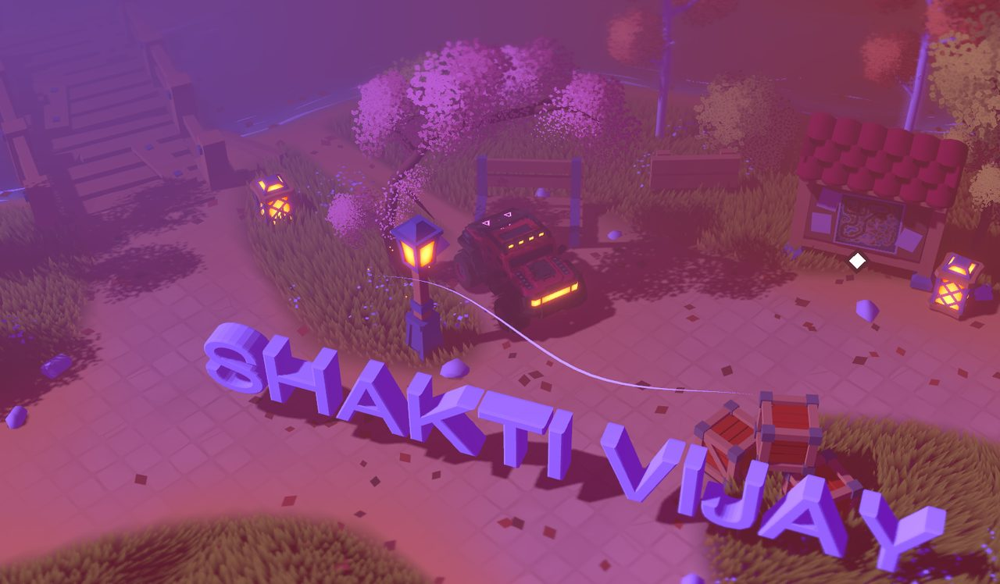
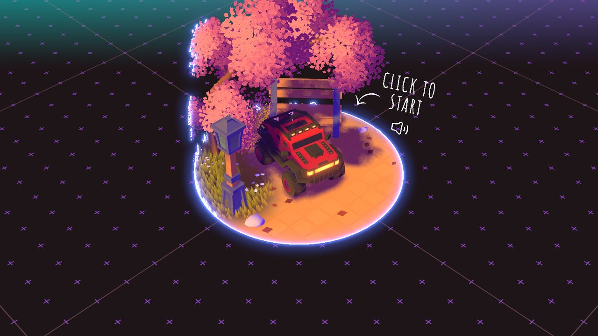
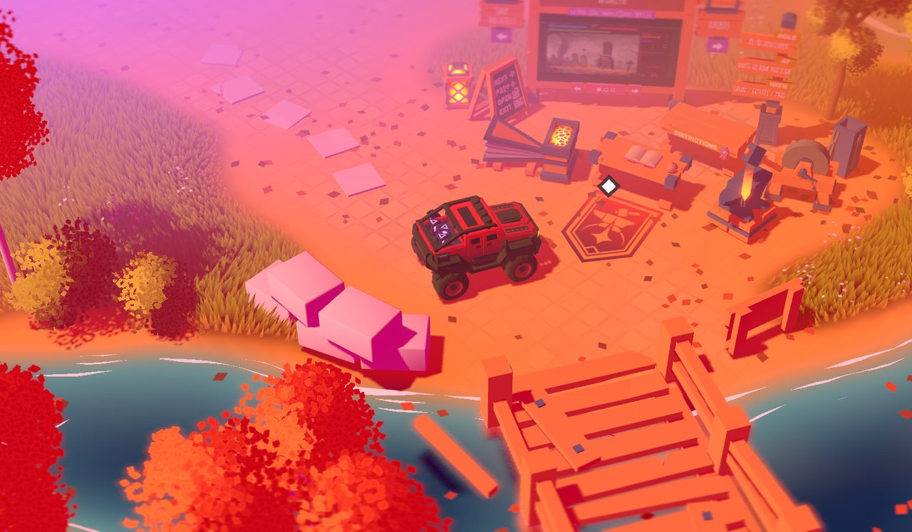
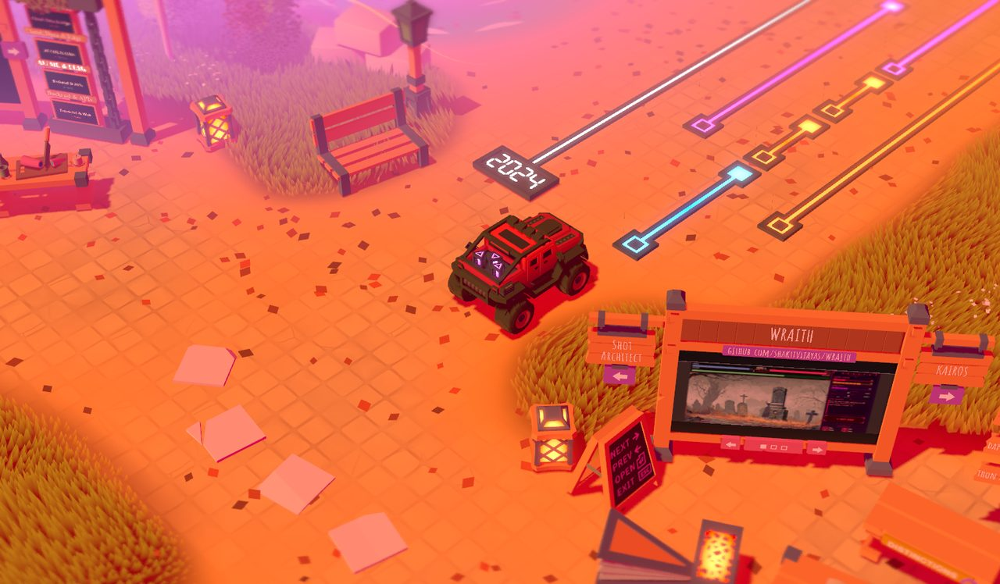
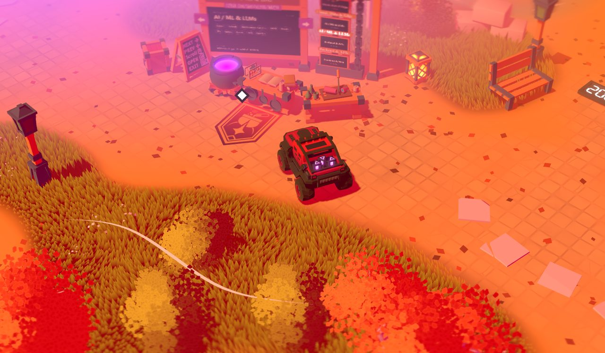
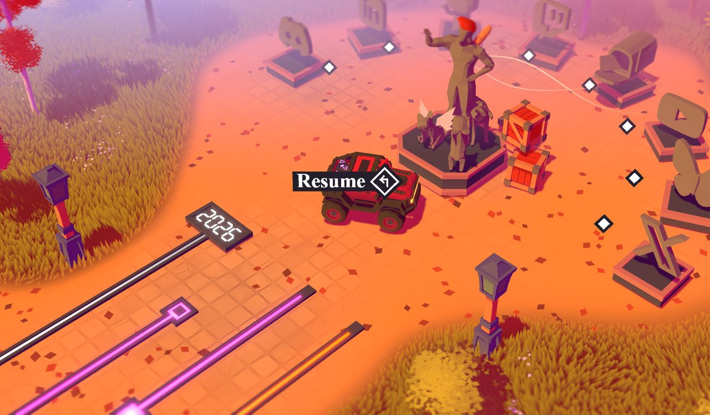
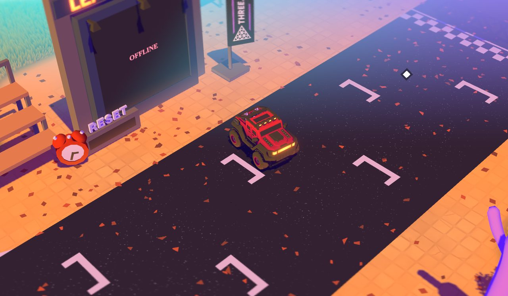
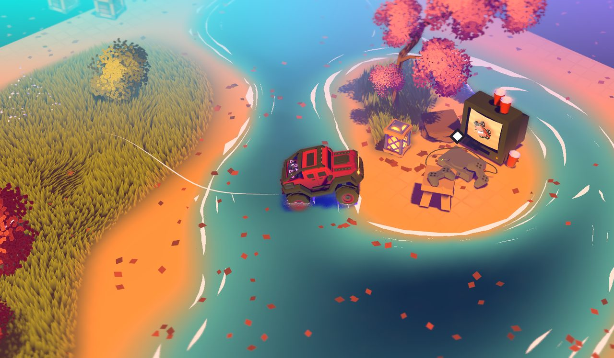

# Shakti Vijay — 3D Portfolio

An interactive 3D portfolio you explore by driving a little off-road truck around a small world. Projects, skills, career milestones and social links are all places you can drive up to.

### 🌐 Live: **[shaktivijayas.github.io/folio-2025](https://shaktivijayas.github.io/folio-2025/)**



## Tour

| | |
|:-:|:-:|
|  |  |
| **Intro** — click (or press Enter / W) to start | **Projects** — browse each project on the big board, open it on GitHub |
|  |  |
| **Career** — a timeline from 2024 to 2026 | **Lab** — skills grouped by area: AI/ML & LLMs, Backend, Frontend, Mobile, DevOps, Cloud & Edge |
|  |  |
| **Social** — drive up to a statue to open GitHub, LinkedIn, Resume, YouTube, Twitch, X, Discord | **Circuit** — a timed race track |



There's more to find: bowling, a time machine, a bonfire, an altar, achievements, and a few easter eggs.

## What's inside

**Projects:** [WRAITH](https://github.com/shaktivijayas/WRAITH) · [KAIROS](https://github.com/shaktivijayas/kairos) · [ZEUS](https://github.com/shaktivijayas/ZEUS) · [ZONE](https://github.com/shaktivijayas/zone) · [DevForge](https://github.com/shaktivijayas/DevForge) · [Aegis](https://github.com/shaktivijayas/aegis) · [GradePath](https://github.com/shaktivijayas/gradepath) · [echomood](https://github.com/shaktivijayas/echomood) · [AuthentiQ](https://github.com/shaktivijayas/AuthentiQ) · [OmniMind](https://github.com/shaktivijayas/omnimind)

**Career:** CIT student (4 years, B.E. CSE) · Freelancing · Top 15 at Replit / India's First Vibethon · Top 20 All India at the Meta Hackathon · AI Innovation Intern at Prodapt Solutions

**Links:** [GitHub](https://github.com/shaktivijayas) · [LinkedIn](https://www.linkedin.com/in/shaktidev/) · [Resume](https://flowcv.com/resume/ab8bp15t6bln) · [YouTube](https://www.youtube.com/@shaktivijay.a.s4087) · [X](https://x.com/Notshakti_)

## Controls

| Action | Keyboard |
|---|---|
| Drive | `W` `A` `S` `D` or arrow keys |
| Boost | `Shift` |
| Brake | `B` or `Ctrl` |
| Interact (open a project / link) | `E`, `F` or `Enter` |
| Jump / bounce suspension | `Space` |
| Honk | `H` |
| Respawn | `R` |

Gamepads and touch also work. Graphics quality starts on **Low** for smooth performance on any device. Switch it to **High** from the menu (top-right) → Options.

## Tech stack

- [Three.js](https://threejs.org/) (TSL shaders, rendered with WebGL)
- [Rapier](https://rapier.rs/) physics
- [GSAP](https://gsap.com/) animations
- [Vite](https://vite.dev/) build
- Models from Blender, compressed with [glTF-Transform](https://gltf-transform.dev/) and KTX2/Basis textures
- Deployed on GitHub Pages via GitHub Actions

## Run it locally

Requires [Node.js](https://nodejs.org/) 20.19 or newer.

```bash
git clone https://github.com/shaktivijayas/folio-2025.git
cd folio-2025
npm install --legacy-peer-deps

npm run dev      # dev server at http://localhost:5173
npm run build    # production build into dist/
```

Optional settings go in a `.env` file (see [`.env.example`](.env.example)), for example `VITE_PLAYER_SPAWN=projects` to start next to an area, or `VITE_MUSIC=0` to mute music. Add `#skip` to the URL to skip the intro.

### Assets

After exporting models from Blender, run `npm run compress`. It compresses `.glb` models and their textures to KTX2 (GPU-friendly) and UI images to WebP, writing new files next to the originals.

## Deployment

Every push to `main` builds the site and publishes it to GitHub Pages ([`.github/workflows/deploy.yml`](.github/workflows/deploy.yml)). Progress shows in the **Actions** tab, and the live site updates about a minute later.

## Credits

Built on [Bruno Simon's folio-2025](https://github.com/brunosimon/folio-2025) (MIT License, © 2025 Bruno Simon), customized with my own content, projects and areas.
